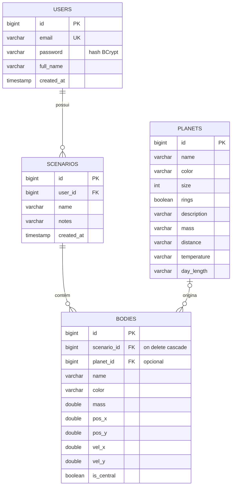

# Orbit°

> Simulador de gravidade newtoniana em tempo real, com catálogo do Sistema Solar e cenários personalizados por usuário.


O **Orbit** é uma aplicação web em **Java + Spring Boot** que mostra o Sistema Solar em movimento e permite
que cada usuário crie seus próprios **cenários**. Cada cenário é uma cópia do Sistema Solar em que é possível
lançar novos **corpos celestes** e ver como eles interagem com o Sol e os planetas. A gravidade é calculada
entre **todos** os corpos, quadro a quadro, no navegador.

---

## Sumário

- [Funcionalidades](#funcionalidades)
- [Tecnologias](#tecnologias)
- [Arquitetura](#arquitetura)
- [Modelo de dados](#modelo-de-dados)
- [Como a simulação funciona](#como-a-simulação-funciona)
- [Autenticação e segurança](#autenticação-e-segurança)
- [Como executar](#como-executar)
- [Rotas](#rotas)
- [Estrutura do projeto](#estrutura-do-projeto)
- [Limitações conhecidas](#limitações-conhecidas)
- [Autores](#autores)

---

## Funcionalidades

### Acesso público (sem login)

| Recurso | Descrição |
|---|---|
| **Página inicial** | Apresentação do projeto com uma animação do Sistema Solar em `<canvas>`. |
| **Catálogo** | O Sol, os oito planetas e Plutão, com dados físicos reais (massa, distância do Sol, temperatura e duração do dia). Os dados vêm do banco e são renderizados com Thymeleaf. |
| **Sandbox** | Simulação gravitacional do Sistema Solar em tempo real, com controles de pausa, reinício e velocidade. Nada é salvo. |
| **Cadastro e login** | Criação de conta e autenticação com JWT. |

### Acesso autenticado

| Recurso | Descrição |
|---|---|
| **Meus cenários** | Lista apenas os cenários do usuário logado, do mais recente ao mais antigo. |
| **Criar cenário** | Todo cenário novo já nasce com o Sistema Solar completo, com cada planeta em órbita circular ao redor do Sol. |
| **Adicionar corpos** | O usuário cria corpos com nome, cor, massa, posição e velocidade. Ao clicar no espaço da simulação, a posição e a velocidade de órbita circular são preenchidas automaticamente. |
| **Interação gravitacional** | Os corpos do usuário atraem e são atraídos por todos os planetas e pelo Sol, deformando órbitas, criando sistemas binários ou ejetando planetas. |
| **Remover corpos e cenários** | O usuário pode remover os corpos que criou (os planetas do catálogo são protegidos) e excluir cenários inteiros. |

---

## Tecnologias

| Camada | Tecnologia |
|---|---|
| Linguagem | Java 21 |
| Framework | Spring Boot 4.1 (Spring Web MVC) |
| Persistência | Spring Data JPA + Hibernate |
| Banco de dados | PostgreSQL |
| Segurança | Spring Security + JWT ([JJWT](https://github.com/jwtk/jjwt) 0.12) + BCrypt |
| Views | Thymeleaf |
| Produtividade | Lombok |
| Front-end | HTML5, CSS3, JavaScript (Canvas 2D) |
| Build | Maven (com Maven Wrapper) |

---

## Arquitetura

A aplicação segue a arquitetura em camadas do Spring:

```
Navegador
   │  cookie "token" (JWT)
   ▼
JwtAuthenticationFilter ──► identifica o usuário a partir do token
   │
   ▼
SecurityConfig ──────────► decide se a rota é pública ou exige login
   │
   ▼
Controller ──────────────► recebe a requisição, devolve uma página (Thymeleaf) ou JSON
   │
   ▼
Service ─────────────────► regras de negócio (dono do cenário, montagem do Sistema Solar...)
   │
   ▼
Repository ──────────────► acesso ao banco via Spring Data JPA
   │
   ▼
PostgreSQL
```

- **DTOs** separam o que entra e sai da aplicação das entidades do banco. A senha nunca sai em uma resposta e
  os formulários não conseguem alterar campos sensíveis, como o dono de um cenário.
- **Catálogo inicial:** o `DataLoader` popula a tabela `planets` automaticamente na primeira execução.
- **Tabelas:** são criadas e atualizadas pelo Hibernate (`ddl-auto=update`).

---

## Modelo de dados



| Tabela | Papel |
|---|---|
| `users` | Contas dos usuários. A senha é armazenada como hash BCrypt. |
| `planets` | Catálogo fixo (Sol, planetas e Plutão), com dados informativos. |
| `scenarios` | Cenários de simulação; cada um pertence a um usuário. |
| `bodies` | Corpos de um cenário, com suas **condições iniciais** (massa, posição e velocidade). Com `planet_id` preenchido, o corpo é um planeta do catálogo. Com `planet_id` nulo, é um corpo criado pelo usuário. |

<details>
<summary>SQL equivalente</summary>

```sql
create table users (
    id         bigserial primary key,
    email      varchar(255) not null unique,
    password   varchar(255) not null,
    full_name  varchar(255) not null,
    created_at timestamp    not null default current_timestamp
);

create table planets (
    id          bigserial primary key,
    name        varchar(255)  not null,
    color       varchar(7)    not null,
    size        integer       not null,
    rings       boolean       not null default false,
    description varchar(2000) not null,
    mass        varchar(255)  not null,
    distance    varchar(255)  not null,
    temperature varchar(255)  not null,
    day_length  varchar(255)  not null
);

create table scenarios (
    id         bigserial primary key,
    user_id    bigint        not null references users(id),
    name       varchar(255)  not null,
    notes      varchar(2000),
    created_at timestamp     not null default current_timestamp
);

create table bodies (
    id          bigserial primary key,
    scenario_id bigint           not null references scenarios(id) on delete cascade,
    planet_id   bigint           references planets(id),
    name        varchar(255)     not null,
    color       varchar(7)       not null,
    mass        double precision not null,
    pos_x       double precision not null,
    pos_y       double precision not null,
    vel_x       double precision not null,
    vel_y       double precision not null,
    is_central  boolean          not null default false
);
```

Não é preciso executar este script: o Hibernate gera as tabelas automaticamente.
</details>

---

## Como a simulação funciona

O banco armazena apenas **onde cada corpo começa e com que velocidade**. O movimento é calculado no navegador
pelo [`sandbox.js`](src/main/resources/static/js/sandbox.js), cerca de 60 vezes por segundo.

### Unidades

Valores reais (G = 6,67×10⁻¹¹, distâncias de bilhões de km) não caberiam em uma tela. Por isso a simulação usa
unidades próprias: **distância em pixels e G = 1**.

| Constante | Valor |
|---|---|
| Massa do Sol | 50 000 |
| Massa dos planetas | igual ao tamanho de desenho (Terra = 7, Júpiter = 16) |
| Raio da primeira órbita | 80 px |
| Distância entre órbitas | 45 px |

### Montagem do Sistema Solar

Ao criar um cenário, o `BodyService` posiciona o Sol parado no centro e cada planeta em uma órbita circular
com a velocidade obtida igualando gravidade e força centrípeta:

```
G·M / r² = v² / r   ⟹   v = √(G·M / r)
```

A velocidade é perpendicular ao raio, e cada planeta começa em um ângulo diferente para não nascerem alinhados.

### Integração numérica

A cada passo, todo corpo recebe a soma das acelerações causadas por **todos** os outros (problema de N corpos):

```
a = G · m_outro / d²      (na direção do outro corpo)
```

- **Euler semi-implícito:** atualiza a velocidade antes da posição, o que mantém as órbitas estáveis.
- **8 subpassos por quadro:** aumentam a precisão em passagens rápidas.
- **Suavização (softening):** evita forças infinitas quando dois corpos ficam muito próximos.
- **Rastros:** mostram a trajetória recente de cada corpo.

### Exemplo

Um corpo com massa 500, posição (200, 0) e velocidade (0, 15):

- **Órbita elíptica:** a velocidade circular a 200 px seria ≈ 15,8. Como recebeu 15, o corpo descreve uma órbita
  elíptica com afélio no ponto onde nasceu.
- **Perturba a Terra:** ao passar a 50 px dela, o corpo a puxa com cerca de **12 %** da força que o Sol exerce,
  e a órbita da Terra se deforma.
- **Move o Sol:** o Sol também é atraído e oscila levemente, já que nenhum corpo é fixo.
- **Sistema binário:** com massa 50 000 (um segundo Sol), o cenário vira um sistema binário caótico.

---

## Autenticação e segurança

- **Cadastro e login:** `POST /auth/register` e `POST /auth/login` validam as credenciais e geram um **JWT**
  assinado com HMAC-SHA256 e validade de 24 horas.
- **Cookie do token:** o token é enviado em um cookie **`HttpOnly`** e **`SameSite=Lax`**. Assim, o navegador o
  envia automaticamente em toda navegação entre páginas, e scripts da página não conseguem lê-lo.
- **Leitura do token:** o `JwtAuthenticationFilter` lê o token do cookie ou do header `Authorization: Bearer`
  e registra o usuário no contexto do Spring Security.
- **Sessão:** a aplicação é **stateless** e não guarda sessão no servidor.
- **Senhas:** são armazenadas com **BCrypt**.
- **Isolamento entre usuários:** um usuário só acessa os próprios cenários. Tentar abrir um cenário de outra
  pessoa retorna **404**, sem revelar que o recurso existe.
- **Redirecionamento:** rotas protegidas acessadas sem login redirecionam para `/login`.
- **Logout:** `POST /logout` apaga o cookie do token.

---

## Como executar

### Pré-requisitos

- JDK 21
- PostgreSQL em execução (porta padrão `5432`)

### 1. Criar o banco

```sql
create database orbit;
```

### 2. Configurar a conexão

Ajuste as credenciais em [`src/main/resources/application.properties`](src/main/resources/application.properties):

```properties
spring.datasource.url=jdbc:postgresql://localhost:5432/orbit
spring.datasource.username=postgres
spring.datasource.password=post

jwt.secret=troque-por-uma-chave-com-pelo-menos-32-caracteres
jwt.expiration=86400000
```

### 3. Executar

```bash
git clone https://github.com/nicholasfocke/Orbit.git
cd Orbit

# Windows
mvnw.cmd spring-boot:run

# Linux / macOS
./mvnw spring-boot:run
```

Acesse **http://localhost:8080**.

Na primeira execução, o Hibernate cria as tabelas e o `DataLoader` popula o catálogo.

> **Atualizando de uma versão anterior?** O `ddl-auto=update` cria colunas, mas não remove as antigas.
> Se a aplicação falhar com erros de coluna `NOT NULL` (como `has_rings` ou `central_body`), recrie as tabelas:
>
> ```sql
> drop table if exists bodies, scenarios, planets, users cascade;
> ```

---

## Rotas

### Páginas

| Método | Rota | Acesso | Descrição |
|---|---|---|---|
| GET | `/` | Público | Página inicial |
| GET | `/catalog` | Público | Catálogo do Sistema Solar |
| GET | `/sandbox` | Público | Simulação do Sistema Solar (somente visualização) |
| GET | `/login` | Público | Tela de login |
| GET | `/register` | Público | Tela de cadastro |
| GET | `/forgot-password` | Público | Tela de recuperação de senha (visual) |
| GET | `/scenarios` | Autenticado | Lista os cenários do usuário |
| GET | `/scenarios/novo` | Autenticado | Formulário de novo cenário |
| POST | `/scenarios` | Autenticado | Cria o cenário com o Sistema Solar |
| GET | `/scenarios/{id}` | Autenticado | Simulação do cenário e formulário de corpos |
| POST | `/scenarios/{id}/bodies` | Autenticado | Adiciona um corpo ao cenário |
| POST | `/scenarios/{id}/bodies/{bodyId}/delete` | Autenticado | Remove um corpo criado pelo usuário |
| POST | `/scenarios/{id}/delete` | Autenticado | Exclui o cenário e seus corpos |
| POST | `/logout` | Autenticado | Encerra a sessão |

### API (JSON)

| Método | Rota | Acesso | Descrição |
|---|---|---|---|
| POST | `/auth/register` | Público | Cria uma conta e devolve o token |
| POST | `/auth/login` | Público | Autentica e devolve o token |
| GET | `/sandbox/bodies` | Público | Corpos do Sistema Solar padrão |
| GET | `/scenarios/{id}/bodies` | Autenticado | Corpos de um cenário do usuário |

<details>
<summary>Exemplos de requisição e resposta</summary>

**`POST /auth/login`**

```json
{ "email": "voce@exemplo.com", "password": "123456" }
```

```json
{ "id": 1, "email": "voce@exemplo.com", "fullName": "Seu Nome", "token": "eyJhbGciOiJIUzI1NiJ9..." }
```

A resposta também traz o header `Set-Cookie: token=...; HttpOnly; SameSite=Lax`.

**`GET /scenarios/{id}/bodies`**

```json
[
  { "name": "Sol", "color": "#ffc93c", "mass": 50000.0, "posX": 0.0, "posY": 0.0,
    "velX": 0.0, "velY": 0.0, "central": true, "size": 22, "rings": false },
  { "name": "Mercúrio", "color": "#9c9c94", "mass": 4.0, "posX": 80.0, "posY": 0.0,
    "velX": 0.0, "velY": 25.0, "central": false, "size": 4, "rings": false }
]
```
</details>

---

## Estrutura do projeto

```
src/main/java/com/orbit/
├── OrbitApplication.java            # ponto de entrada
├── config/
│   └── DataLoader.java              # popula o catálogo na primeira execução
├── controller/
│   ├── AuthController.java          # API de cadastro/login (JWT + cookie)
│   ├── AuthPageController.java      # páginas de login e cadastro
│   ├── CatalogController.java       # catálogo do Sistema Solar
│   ├── HomeController.java          # home, sandbox público e seu JSON
│   ├── ScenarioController.java      # cenários e corpos do usuário
│   └── GlobalModelAttributes.java   # informa às páginas se há usuário logado
├── dto/
│   ├── AuthRequest.java / AuthResponse.java
│   ├── ScenarioRequest.java
│   └── BodyRequest.java / BodyResponse.java
├── model/
│   ├── User.java
│   ├── Planet.java
│   ├── Scenario.java
│   └── Body.java
├── repository/
│   ├── UserRepository.java
│   ├── PlanetRepository.java
│   ├── ScenarioRepository.java
│   └── BodyRepository.java
├── security/
│   ├── JwtProvider.java             # gera e valida tokens
│   ├── JwtAuthenticationFilter.java # lê o token do cookie/header
│   └── SecurityConfig.java          # regras de acesso, logout e BCrypt
└── service/
    ├── AuthService.java             # cadastro e login
    ├── PlanetService.java           # catálogo
    ├── ScenarioService.java         # cenários do usuário
    └── BodyService.java             # Sistema Solar, corpos e conversão para JSON

src/main/resources/
├── application.properties
├── templates/                       # páginas Thymeleaf
│   ├── fragments/ (header, footer)
│   ├── index, catalog, sandbox
│   ├── login, register, forgot-password
│   └── scenarios, scenario-form, scenario-details
└── static/
    ├── css/                         # estilos por página
    └── js/
        ├── sandbox.js               # motor de física N-corpos
        ├── solar-system.js          # animação da página inicial
        ├── catalog.js / planet-viewer.js
        └── planets-data.js
```

---

## Limitações conhecidas

- **CSRF desativado:** a proteção CSRF do Spring Security está desligada. O cookie `SameSite=Lax` reduz o
  risco, mas um ambiente de produção deve reativá-la.
- **Segredos no arquivo de configuração:** o `jwt.secret` e as credenciais do banco ficam em
  `application.properties`. Em produção, devem vir de variáveis de ambiente.
- **Recuperação de senha:** a tela é apenas visual e nenhum e-mail é enviado.
- **Colisões:** não há detecção de colisão entre corpos; corpos muito próximos apenas se atravessam.

---

## Autores

| | |
|---|---|
| **Nicholas Focke** | [@nicholasfocke](https://github.com/nicholasfocke) |
| **Igor Rafael** | |

Projeto acadêmico desenvolvido para a disciplina de física da faculdade.
